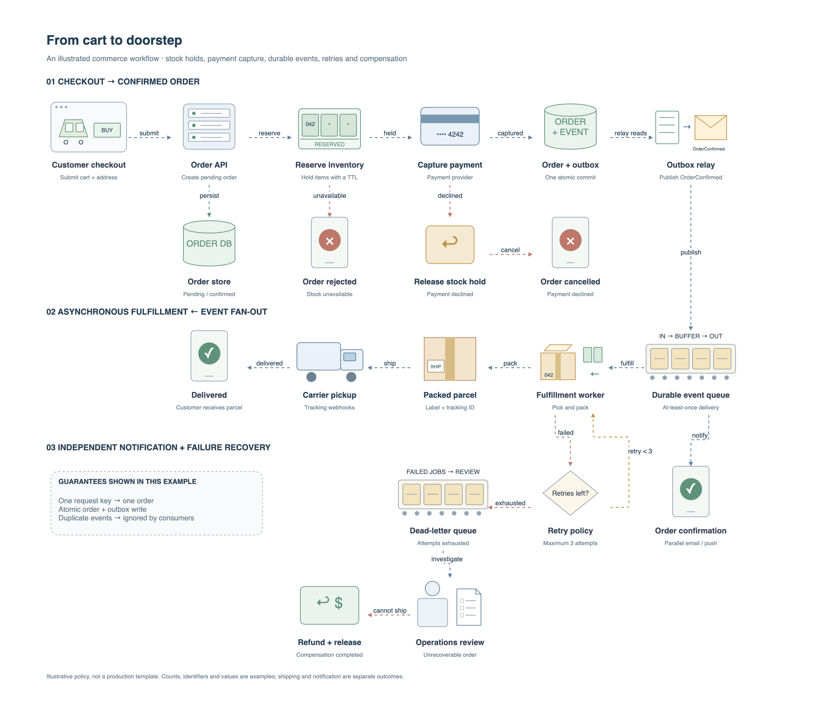
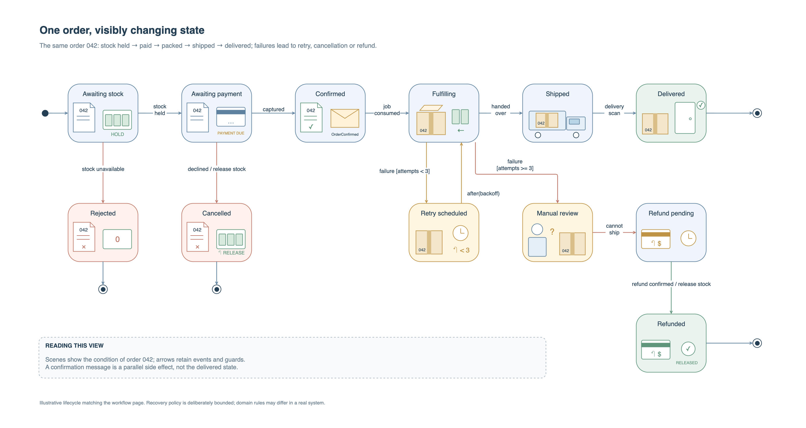
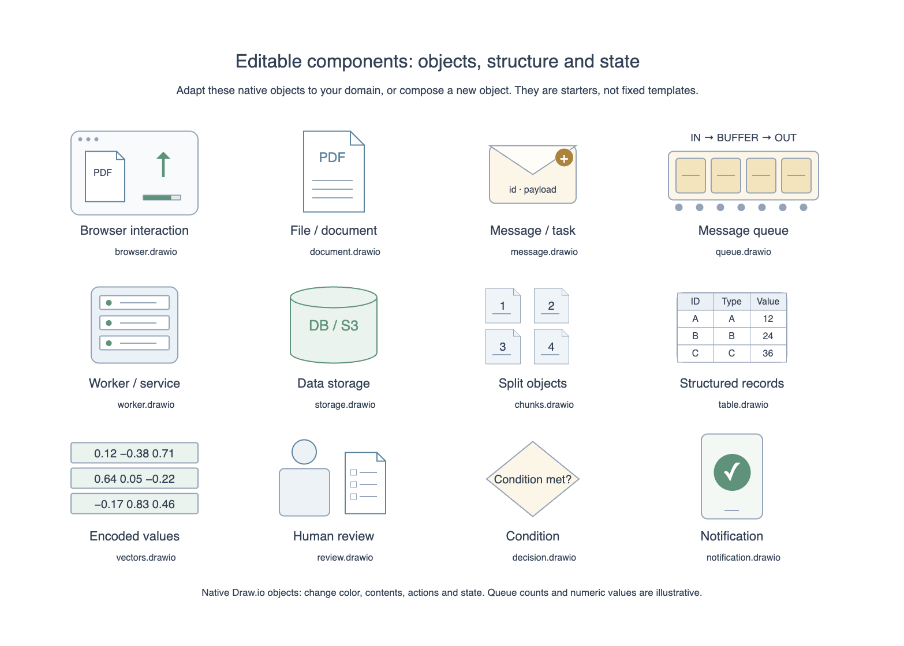

# Drawio Foundry

[Chinese README](README.zh-CN.md) · [Skill instructions](SKILL.md) · [Apache-2.0](LICENSE)

An Agent Skill for creating editable Draw.io diagrams that explain objects, interactions, and transformations. It combines diagram-selection guidance, reusable native components, file operations, and checks against the official Draw.io renderer.



## What it does

- Honors the requested diagram type and orientation. When the type is open, chooses by the reader's question: flowcharts, swimlanes, UML sequence/state/component/deployment/class diagrams, ER diagrams, data flows, and other suitable forms.
- Explains processes with recognizable objects and visible changes, while retaining formal notation where it communicates best.
- Includes 12 editable starters: browser, document, message, queue, worker, storage, chunks, table, vectors, human review, decision, and notification. These are a seed library, not a capability limit: agents can combine, adapt, or draw additional native objects for the task.
- Inspects and patches native `.drawio` files, checks layout and directed topology, manages pages, and preserves prior versions through no-clobber writes.
- Exports through Draw.io Desktop or the official web tools. The bundled Python tools do not implement a renderer or automatic layout engine.
- Produces PNGs and HTML previews by default. Verified PNGs can be embedded for offline viewing; online interaction supports native tooltips and editing a copy.

## Install as a skill

Clone this repository into a `drawio-foundry` folder inside your agent's skills directory. Preserve the directory structure so references, scripts, and component assets remain available.

```bash
git clone https://github.com/henry867/drawio-foundry.git /path/to/your/skills/drawio-foundry
```

Use your agent's normal skill-discovery mechanism, or direct it to read `SKILL.md`. If the host supports dollar-prefixed skill invocation:

```text
Use $drawio-foundry to explain this document-ingestion pipeline.
Choose a suitable diagram type, show the data transformations,
and deliver a verified image and offline-capable HTML preview.
```

The skill does not require an MCP server. Its optional `agents/openai.yaml` provides host-specific display metadata; the instructions, assets, and Python CLI can also be used independently.

## Requirements

| Capability | Requirement |
|---|---|
| Inspect, query, patch, validate, layout/topology checks, preview generation | Python 3.10+; standard library only |
| Native diagram authoring | An agent writing Draw.io XML, or Mermaid conversion through Draw.io Desktop |
| Desktop export | Draw.io Desktop; auto-detected on macOS and Linux |
| Web preview/export fallback | A compatible browser and access to the official diagrams.net services |
| Offline HTML viewing | A preview generated with a verified fallback PNG for every page |

The helper does not auto-install Draw.io or a browser. Desktop-only exports need Desktop; otherwise the skill uses the official Viewer/Web workflow and reports missing dependencies. Browser automation depends on the tools available to the agent.

## Try the CLI

From the repository root:

```bash
python3 scripts/drawio_file.py inspect examples/ecommerce-order.drawio
python3 scripts/drawio_file.py check-layout examples/ecommerce-order.drawio
python3 scripts/drawio_file.py check-topology examples/ecommerce-order.drawio \
  --page-id checkout-flow --start checkout \
  --terminal delivered --terminal notify_customer --terminal rejected \
  --terminal cancelled --terminal refunded --terminal order_db \
  --expect-edge event_queue fulfillment \
  --expect-edge event_queue notify_customer --require-connected
```

With Draw.io Desktop installed, generate a new PNG and an offline-capable HTML preview:

```bash
mkdir outputs
python3 scripts/drawio_file.py render examples/ecommerce-order.drawio \
  --page-index 0 --output outputs/commerce-v001-page-01.png
python3 scripts/drawio_file.py render examples/ecommerce-order.drawio \
  --page-index 1 --output outputs/commerce-v001-page-02.png
python3 scripts/drawio_file.py preview examples/ecommerce-order.drawio \
  --output outputs/commerce-v001.html \
  --fallback-png outputs/commerce-v001-page-01.png \
  --fallback-png outputs/commerce-v001-page-02.png
```

Choose a new output path for subsequent writes. These commands do not overwrite the input. Without a fallback PNG, the generated HTML requires the remote Viewer. Offline PNG viewing does not provide interactive tooltips or web editing.

## Example: e-commerce checkout and fulfillment

The editable commerce example contains two complementary views, both with English labels:

1. **Illustrated workflow** (above): reserve inventory, capture payment, atomically commit an order and outbox record, publish a durable event, and fan out to fulfillment and notification consumers. It also shows stock rejection, payment compensation, bounded retries, a dead-letter queue, operations review, and refunds.
2. **Order state machine** (below): follow the same order through confirmation, fulfillment, delivery, cancellation, retry, and refund states. Editable scenes inside the state boundaries show stock on hold, a pending payment, an order plus event, packing, a parcel aboard a truck, delivery, retries, and refunds. Transition events and guards retain their state-machine meaning.



This is an illustrative policy, not a production template. The example distinguishes order confirmation from shipment and delivery, and separates an independent notification from the order's state.

Editable examples: [commerce workflow and lifecycle](examples/ecommerce-order.drawio), [English component gallery](examples/components-en.drawio).

<details>
<summary>View the starter component gallery</summary>



The parcel, payment card, stock tray, and carrier truck in the workflow demonstrate how agents can compose objects beyond the 12 starters.

</details>

## How the skill is organized

| Path | Purpose |
|---|---|
| [SKILL.md](SKILL.md) | Main entry point, scope, workflow, and delivery rules |
| [Diagram selection](references/diagram-selection.md) | Choose UML or non-UML forms by the question being answered |
| [Visual storytelling](references/visual-storytelling.md) | Compose objects, actions, state changes, and verified ownership |
| [Native components](assets/components) | Small editable starters to adapt or combine |
| [Authoring](references/authoring.md) | Desktop/Web export and offline preview procedures |
| [Layout](references/layout-authoring.md) and [topology](references/topology.md) | Geometric risks, semantic paths, and rendered QA |
| [Scripts](scripts) | Standard-library file tooling and the optional loopback Web SVG session |

## Verification and limitations

```bash
python3 -m unittest discover -s tests -v
```

The automated checks exercise bundle references, native assets, directed paths, revision protection, no-clobber behavior, XML rejection, and offline-preview packaging. They do not prove visual quality. The supplied preview images were inspected after official Viewer rendering; changed diagrams still need their own rendered QA.

`check-layout` is a bounded geometry linter. It reports `EDGE_LABEL_ENDPOINT_OVERLAP_RISK` when estimated connector text enters a connected shape's clearance. The skill requires room for the full label, meaningful line breaks or a clear alternate position, followed by inspection of actual rendered text bounds. Unresolved label overlap blocks `ready`; a white label background or smaller font is not a clearance fix.

An `indeterminate` result still requires rendered review; an empty collision list alone is not visual acceptance. Topology checks verify explicit connections and reachability, not whether a business claim is true.

Interactive previews load JavaScript from `viewer.diagrams.net`. Web editing and SVG export use `embed.diagrams.net`; opening an editor or exporting through the Web sends diagram content to that official service. Use Desktop and the PNG fallback for an offline workflow.

## Contributing

Keep changes focused and preserve editable native objects, supported notation, and existing user content. For a new component, provide a recognizable semantic object rather than a screenshot. For a new diagram rule, explain which reader question it answers; avoid imposing one visual style on every task. Run the tests and include official-renderer evidence for visual changes.

## License and attribution

Distributed under [Apache License 2.0](LICENSE). Preserve [NOTICE](NOTICE) when redistributing.

The existing documentation and command-pattern attribution is retained for [JGraph drawio-mcp](https://github.com/jgraph/drawio-mcp/tree/14b318b19cc37b159f841227b9d11fbd18ce18ea) and the compressed-page compatibility reference [next-ai-draw-io](https://github.com/DayuanJiang/next-ai-draw-io/tree/be8f26d6b17c4a1baafb78be19bb689398b8b721). Pinned references and details are recorded in `NOTICE`.

This is an independent project, not an official JGraph or OpenAI distribution. Draw.io and diagrams.net are trademarks of their respective owners.
