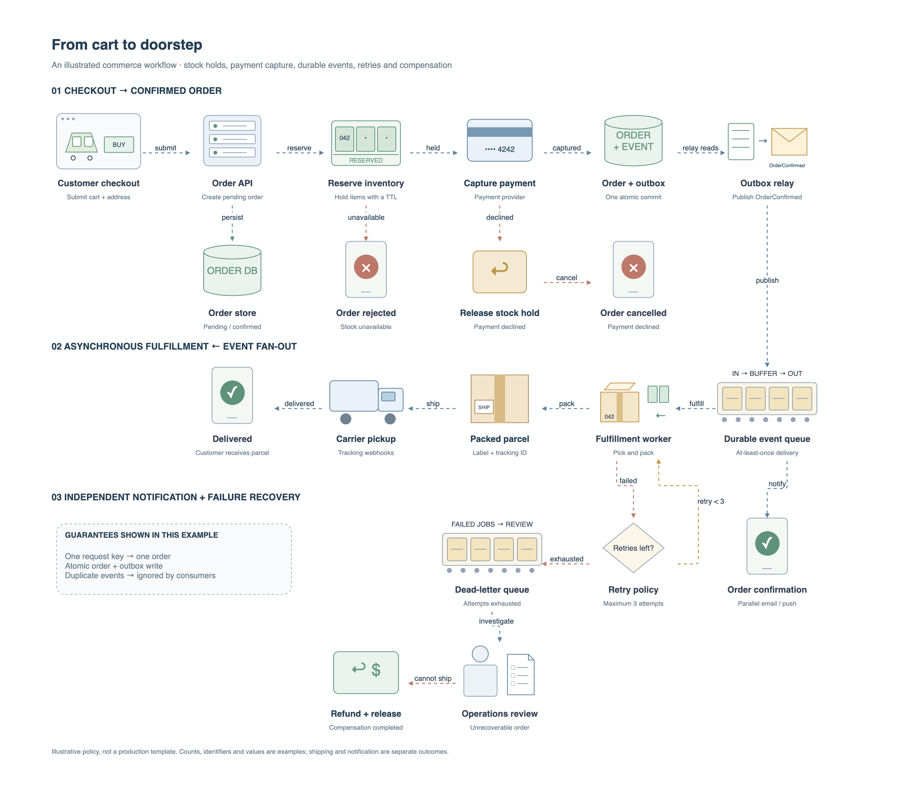
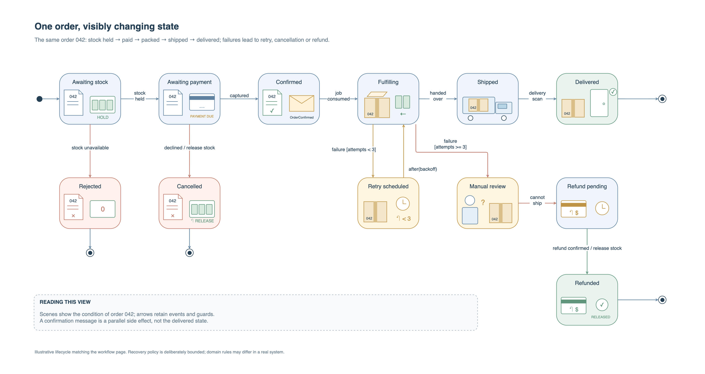

# Drawio Visuals Skill

[English](README.md) · [Skill 主入口](SKILL.md) · [Apache-2.0](LICENSE)

一个用于绘制可编辑 Draw.io 图的 Agent Skill。它提供选图方法、具象化表达指导、可复用原生构件，以及文件操作、布局检查、连通性检查和官方渲染工作流。



## 核心能力

- **按内容选图**：优先遵循用户指定的类型、符号和方向；未指定时，根据要解释的问题选择 UML 或非 UML 图式，不默认画流程图或泳道图。
- **让图形承担表达**：呈现对象、动作、结构和前后变化，区分消息、队列、处理器与存储；同时保留类图、时序图、状态图、ER 图等规范符号的语义。
- **12 个起始构件，能力不限于此**：页面、文件、消息、队列、处理器、存储、文档块、结构化记录、向量、人工审阅、条件判断和通知。这是可复用的起点，不是全部图形类型；Agent 可以组合、改造或按同一方法绘制目录之外的新对象。
- **原生文件操作**：检查、查询、补丁修改、页面管理和不可覆盖的新版本输出。
- **验证与交付**：检查布局和显式流程连通性，通过 Draw.io Desktop 或官方 Web 渲染，默认交付 PNG 和 HTML。
- **离线预览**：HTML 可嵌入每页已验证的 PNG；在线预览支持组合对象的悬停说明和编辑副本。

## 安装

将仓库克隆到你的 Agent 的 skills 目录下，文件夹名保留为 `drawio-visuals-skill`，并保留内部目录结构：

```bash
git clone https://github.com/henry867/drawio-visuals-skill.git /path/to/your/skills/drawio-visuals-skill
```

通过 Agent 自身的 Skill 发现机制加载，或让它读取 `SKILL.md`。如果宿主支持 `$` 形式的 Skill 调用：

```text
使用 $drawio-visuals-skill 梳理这条文档入库链路。
根据内容选择合适的图式，展示数据如何变化，
交付经过渲染检查的图片和可离线查看的 HTML。
```

不依赖 MCP 服务。`agents/openai.yaml` 是可选的宿主显示信息；指导、构件和 Python CLI 也可独立使用。

## 环境要求

文件操作、布局/连通性检查和 HTML 生成需要 **Python 3.10+**，Python 工具只使用标准库。

Desktop 导出需要安装 Draw.io Desktop，目前提供 macOS、Linux 检测。没有 Desktop 时，可以由 Agent 使用可用的浏览器工具，通过官方 Viewer/Web 完成预览或导出。工具不会自动安装 Desktop 或浏览器，也不实现自定义渲染器、自动布局引擎。

离线查看 HTML 时，需要生成预览时为每页传入已验证的 PNG。离线图片不提供悬停说明或 Web 编辑。

## 快速使用

在仓库根目录运行：

```bash
python3 scripts/drawio_file.py inspect examples/ecommerce-order.drawio
python3 scripts/drawio_file.py check-layout examples/ecommerce-order.drawio
python3 scripts/drawio_file.py check-topology examples/ecommerce-order.drawio \
  --page-id checkout-flow --start checkout \
  --terminal delivered --terminal notify_customer --terminal rejected \
  --terminal cancelled --terminal refunded --terminal order_db \
  --expect-edge event_queue fulfillment \
  --expect-edge event_queue notify_customer --require-connected
```

安装 Desktop 后，可导出新图片和 HTML：

```bash
mkdir outputs
python3 scripts/drawio_file.py render examples/ecommerce-order.drawio \
  --page-index 0 --output outputs/commerce-v001-page-01.png
python3 scripts/drawio_file.py render examples/ecommerce-order.drawio \
  --page-index 1 --output outputs/commerce-v001-page-02.png
python3 scripts/drawio_file.py preview examples/ecommerce-order.drawio \
  --output outputs/commerce-v001.html \
  --fallback-png outputs/commerce-v001-page-01.png \
  --fallback-png outputs/commerce-v001-page-02.png
```

后续写入选择新的输出文件名，输入文件不会被覆盖。未提供 fallback PNG 的 HTML 依赖联网加载官方 Viewer。

## 示例

新的电商示例包含两张互补视图，默认图中文字均为英文：

1. **具象化订单流程**（上图）：库存预占、支付、订单与 Outbox 原子提交、消息队列、履约与通知扇出，以及库存不足、支付失败、重试、死信队列、人工处理和退款补偿。
2. **订单状态机**（下图）：描述同一订单从确认到履约、发货、送达、取消、重试和退款的状态变化，在状态边界内用库存托盘、支付卡、订单与消息、装箱、载货货车、签收和退款画面表达变化，同时保留状态和转移的语义。



示例是虚构策略，不是生产模板。订单确认、发货、送达分别表示不同阶段，独立通知也不等于订单已完成。支付卡、库存托盘、包裹和货车展示了目录之外图形的组合方法。

原生文件：[电商流程与状态机](examples/ecommerce-order.drawio)、[英文构件图谱](examples/components-en.drawio)。

## 指导与验证

- [选图规则](references/diagram-selection.md)：从用户要理解的问题选择呈现方式。
- [具象化方法](references/visual-storytelling.md)：对象、结构、动作、变化、归属与构件复用。
- [布局检查](references/layout-authoring.md)、[连通性检查](references/topology.md)、[导出和预览](references/authoring.md)。

运行自动校验：

```bash
python3 -m unittest discover -s tests -v
```

自动校验覆盖构件、引用、显式流程路径、版本保护、禁止覆盖、XML 拒绝和离线预览打包。新增的 `EDGE_LABEL_ENDPOINT_OVERLAP_RISK` 会提示连接线标签侵入两端图形安全间距的风险。Skill 要求为完整标签预留空间，通过增加间距、合理换行或调整位置解决，并检查实际渲染边界；仍有标签重叠时不能标记为 `ready`。

这些检查不能替代官方渲染结果的视觉检查。`check-layout` 返回 `indeterminate` 时仍需检查渲染；没有连线碰撞也不等于文字已经易读。

在线交互依赖 `viewer.diagrams.net`；Web 编辑和 SVG 导出使用 `embed.diagrams.net`，会将图内容发送到对应官方服务。需要离线工作时使用 Desktop 和 PNG fallback。

## 许可证与贡献

采用 [Apache-2.0](LICENSE)，保留现有 [NOTICE](NOTICE) 和上游归属。上游参考为 [JGraph drawio-mcp](https://github.com/jgraph/drawio-mcp/tree/14b318b19cc37b159f841227b9d11fbd18ce18ea) 与 [next-ai-draw-io](https://github.com/DayuanJiang/next-ai-draw-io/tree/be8f26d6b17c4a1baafb78be19bb689398b8b721)。

欢迎补充原生构件、选图方法和有证据的修复。请保持修改聚焦，运行测试；涉及图形变化时附上官方渲染结果。这个项目不是 JGraph 或 OpenAI 的官方发行版。
